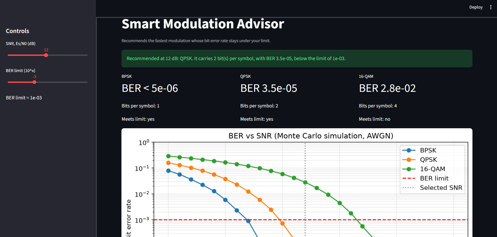
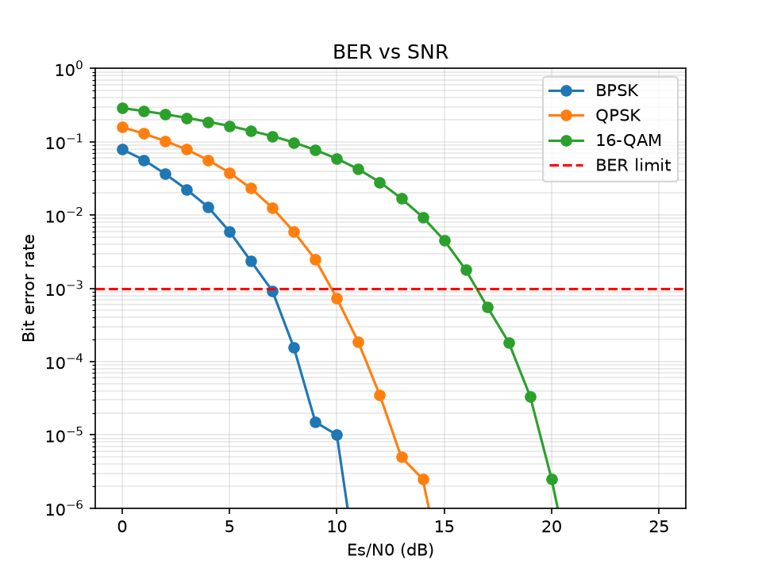

# Smart Modulation Advisor
**Live demo:** https://smart-modulation-advisor-82xrmchur7tvnxsisektcq.streamlit.app/

A Python simulator and interactive app that recommends the **fastest modulation scheme** (BPSK, QPSK or 16-QAM) whose bit error rate (BER) stays under a user-set limit at the current signal quality (SNR).



## How to run

```
pip install -r requirements.txt
streamlit run app/streamlit_app.py
```

Run the tests with `python -m pytest`.

## How it works

1. Random bits are mapped to symbols (BPSK: 2 points, QPSK: 4, 16-QAM: 16, Gray mapped, average energy 1).
2. Complex Gaussian noise (AWGN) is added at the chosen Es/N0.
3. The receiver picks the nearest constellation point and the BER is counted.
4. The advisor keeps every scheme whose BER is below the limit and picks the one with the most bits per symbol. If none qualifies, it says so.

SNR is Es/N0 (energy per symbol over noise density), in dB.

## Results



At a BER limit of 1e-3, the simulated curves cross the limit at roughly 7 dB (BPSK), 10 dB (QPSK) and 16-17 dB (16-QAM). These switching points come from the simulation, not from fixed thresholds.

## Features

- Monte Carlo BER simulation for BPSK, QPSK and 16-QAM
- Adjustable SNR and BER limit
- Live recommendation with the calculated BER
- BER vs SNR plot with the limit line
- Results table with CSV download
- Unit tests with pytest

## Validation

The simulated BER matches theory at spot checks, for example BPSK at 0 dB (about 0.08) and QPSK at 12 dB (about 3.5e-05).

## Limitations

- Simulation only: it does not control a real WiFi, 4G or 5G connection.
- AWGN channel only: no fading, interference or error-correcting codes.
- Monte Carlo results use 200,000 symbols per point, so BERs below about 5e-06 are not measured reliably.
- Switching points depend on the chosen BER limit and the SNR definition.

## Project structure

```
simulator/   modulation, noise and BER code
app/         Streamlit app
tests/       pytest tests
results/     plots and screenshots
docs/        design documents
```

## Future scope

Error-correcting codes, a fading channel, more schemes (8-PSK, 64-QAM), and a live deployment.

## Authors

- Prateek Prameet Padhy ([@pratweeakk-dvz](https://github.com/pratweeakk-dvz)): simulator, BER plots, advisor logic, Streamlit app, tests
- Niharika Jha ([@niharikajha2307](https://github.com/niharikajha2307)): README review and documentation 